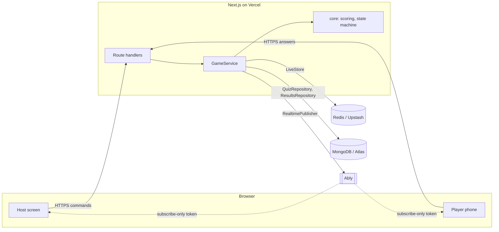

# Architecture

## Shape: ports and adapters

The game rules know nothing about Redis, MongoDB or Ably. They talk to four small interfaces (`src/ports/index.ts`). Adapters implement them, and one composition root (`src/lib/container.ts`) wires adapters from environment configuration.

| Layer | Path | Rule |
|---|---|---|
| Core | `src/core` | Pure functions and types. No I/O. |
| Ports | `src/ports` | Interfaces only. |
| Services | `src/services` | Orchestration. Depends on ports, never adapters. |
| Adapters | `src/adapters/*` | One folder per technology. |
| Composition | `src/lib/container.ts` | The only file that names concrete adapters. |
| UI/API | `src/app`, `src/components` | Thin: validate input, call `GameService`. |

## Data ownership

| Data | Store | Lifetime |
|---|---|---|
| Quizzes, question banks | MongoDB | Permanent |
| Final results and history | MongoDB | Permanent |
| Session, players, scores, answers | Redis | Hours (TTL), then gone |
| Join code and capacity budget | Redis | Session |

Redis is never the system of record for anything a user would be upset to lose: a finished session is snapshotted to MongoDB before its live state is released.

## Request flow of a round

1. Host `POST`s `start`. `GameService` runs the pure state machine, saves the session in Redis (timestamped with Redis `TIME`), and publishes a `question` event. The payload is built by `toPublicQuestion`, which cannot include the correct answer.
2. Players receive the event over Ably and tap an option. The browser `POST`s the answer.
3. `LiveStore.recordAnswer` runs one Lua script: is the session on this question, has this player answered, is it late, who is first correct. Elapsed time is computed inside Redis, so client clocks are irrelevant.
4. `GameService` computes points with the pure `computeScore` and does `ZINCRBY` on the leaderboard.
5. Host `POST`s `reveal`. Correct option and top 10 are published. `next` repeats from step 1, or ends the session.
6. On end, the ranking is saved to MongoDB, an `ended` event is published, and live capacity is released.

## Fairness and security properties

- The correct option never leaves the server before `reveal`. Test: `tests/game.test.ts`.
- One answer per player per question, enforced atomically, not by the UI. Test: contract suite, including 20 concurrent answers yielding exactly one "first correct".
- Late answers are rejected by Redis time, with a fixed 300 ms jitter allowance.
- Browsers hold an Ably token that can only subscribe to one session channel. The API key stays on the server.
- Host commands check `session.hostId` on every call.

## Free-tier guard rails

The binding limits are connection counts (Ably free is 200 concurrent connections, per Ably's docs; verify before relying on it). The app therefore enforces:

- `maxPlayers` per session, clamped to `MAX_PLAYERS_PER_SESSION`.
- A global player budget `MAX_PLAYERS_GLOBAL` across all live sessions, held in Redis. It self-heals: entries for sessions that expire without a clean end are pruned on the next join.
- A clear "server full" outcome instead of degraded service for everyone.

## Background jobs

There are none for game logic. Cleanup uses Redis key expiry. The only scheduled job is a weekly GitHub Actions ping to `/api/health?deep=1` so free-tier databases that pause when idle stay warm.

## Resilience: reconnecting

The database is the source of truth and push is an optimisation. `GameService.snapshot()` rebuilds the full client state (status, question, leaderboard) from Redis, so a reloaded or reconnecting phone loses nothing. It also gives a polling fallback if the push provider is down.

## Testing strategy

| Layer | Approach |
|---|---|
| Core | Table-driven unit tests, no mocks. |
| Service | Full game loop on memory adapters with an injected clock. |
| Adapters | One shared contract suite per port, run against memory and real Redis (CI service container). |
| Config | Env validation tests. |
| End to end | `npm run e2e`: a real browser plays a full game (host + 3 phones); runs on memory or Redis, in CI against a Redis service. |
| Capacity | `tests/load.test.ts`: 140 join attempts and 100 concurrent answers on real Redis; asserts the global budget and one-time bonus. |
